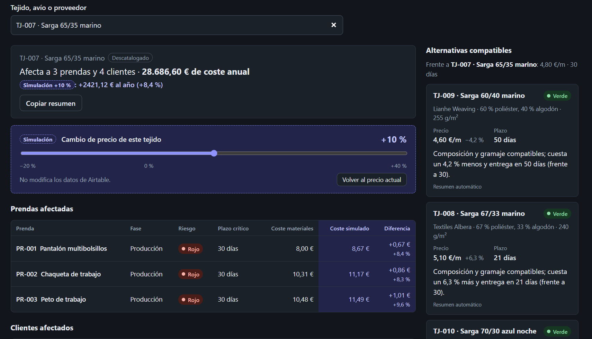

# Análisis de impacto de materiales

Prototipo de PLM que responde en segundos a una pregunta clave: **si cambia un tejido, un avío o un proveedor, ¿qué prendas, qué clientes y cuánto coste se ven afectados?**

Airtable es la fuente de verdad. Encima hay una web en Vue que busca el material, calcula el impacto, simula cambios de precio y propone alternativas compatibles. Todos los datos son ficticios.



El planteamiento de negocio completo está en [docs/PRD.md](docs/PRD.md).

## Qué hace

1. **Buscar** un tejido, un avío o un proveedor por código o nombre.
2. **Ver dónde se usa.** La respuesta clave va primero, en una frase ("Afecta a 3 prendas y 4 clientes · 28.686,60 € de coste anual"). Debajo aparecen las prendas afectadas, con su fase y un semáforo de riesgo, y los clientes, con sus unidades y su coste anual.
3. **Simular** una subida o bajada de precio entre −20 % y +40 %. Muestra el coste simulado y la diferencia en € y en % por prenda y por cliente. La simulación se calcula en memoria, está marcada como tal y nunca escribe en Airtable.
4. **Comparar alternativas.** Para un tejido o un avío propone hasta 3 materiales compatibles, con precio, plazo, riesgo y una frase que explica por qué encajan.
5. **Compartir.** Copia un resumen en texto para enviarlo a Cuentas o a Compras.

El semáforo de riesgo por prenda funciona así:

- **Rojo:** la prenda está en producción y usa un material descatalogado.
- **Ámbar:** algún material está en revisión o el plazo crítico supera los 60 días.
- **Verde:** el resto.

## Arquitectura

```text
Navegador (Vue 3)  ──►  /api (funciones de Vercel)  ──►  Airtable (REST, solo lectura)
                                   │
                                   └──►  API de Anthropic (solo la frase de cada alternativa)
```

- **El navegador solo habla con `/api`.** Nunca llama a Airtable ni al LLM, y ninguna variable de entorno llega al cliente.
- **Airtable calcula, el código lee.** El coste de materiales, el plazo crítico y el riesgo son rollups y fórmulas de Airtable. La API los lee tal cual y no los recalcula. La configuración está en [docs/campos-calculados.md](docs/campos-calculados.md).
- **Respeta los límites de Airtable** (5 peticiones por segundo por base):
  - Cada función lee las tablas una vez y guarda esa foto en caché 60 s.
  - Espacia las peticiones a 250 ms.
  - Si Airtable devuelve un error 429, lo explica en lugar de reintentar sin control.

### Endpoints

| Método | Ruta | Devuelve |
| --- | --- | --- |
| GET | `/api/search?q=` | Tejidos, avíos y proveedores que coinciden |
| GET | `/api/impact?tipo=tejido\|avio\|proveedor&id=` | Prendas afectadas y clientes, con unidades y coste anual |
| GET | `/api/alternatives?id=` | Hasta 3 materiales compatibles, con coste, plazo, riesgo y una frase |

### Alternativas: regla determinista y LLM

Las alternativas **no las elige el LLM**. Las elige una regla:

- **Tejidos:** las mismas fibras, cada una a ±10 puntos de la original, y un gramaje dentro de ±10 %.
- **Avíos:** el mismo tipo.
- **Nunca se proponen** el material de referencia ni los descatalogados.

Se ordenan por riesgo, precio y plazo, y se quedan las 3 primeras.

Claude Haiku solo redacta una frase por alternativa ya filtrada:

- Hace una única llamada con salida estructurada y esfuerzo bajo.
- Solo usa los datos que recibe.
- Si devuelve una frase para un material que no está en la lista, se descarta.
- Las frases se guardan en caché una hora.

Si no hay `ANTHROPIC_API_KEY`, o el modelo falla o rechaza la petición, cada alternativa lleva una frase generada con una plantilla a partir de los mismos datos. La interfaz indica si la frase la redactó la IA o es un resumen automático, así que la demo funciona siempre y sin coste.

## Estructura

```text
api/         Funciones de Vercel: un archivo por endpoint
  _lib/      Lectura de Airtable, caché, rutas y redactor de alternativas
shared/      Lógica pura compartida: compatibilidad, impacto, alternativas, simulación y tipos
src/         Frontend en Vue 3
scripts/     Seed de la base de demo
tests/       Tests de Vitest (lógica, rutas con dobles y componentes)
docs/        PRD, campos calculados, vistas y automatización de Airtable
```

## Puesta en marcha

Requisitos: Node 26 y una cuenta de Airtable. La cuenta de Vercel y la clave de Anthropic son opcionales.

1. **Instala las dependencias** con `npm install`.
2. **Crea `.env.local`** en la raíz, sin subirlo al repositorio, con estas variables:

   | Variable | Para qué |
   | --- | --- |
   | `AIRTABLE_BASE_ID` | Base de Airtable |
   | `AIRTABLE_TOKEN_READ` | Token de solo lectura, para la app (en local y en Vercel) |
   | `AIRTABLE_TOKEN_WRITE` | Token de escritura, solo en local y solo para el seed |
   | `ANTHROPIC_API_KEY` | Opcional: sin ella, las frases salen de la plantilla |

   Ninguna variable lleva el prefijo `VITE_`, para que Vite no las exponga al navegador.

3. **Crea las tablas y los datos de demo** con `npm run seed`. Si la base ya tiene datos, `npm run seed -- --reset` borra los registros (nunca las tablas) y los vuelve a crear.
4. **Crea a mano los campos calculados** siguiendo [docs/campos-calculados.md](docs/campos-calculados.md). La API de Airtable no permite crear fórmulas, lookups ni rollups.
5. **Opcional: configura las vistas y el aviso a Cuentas** (kanban de prendas por fase y correo al descatalogar un material) siguiendo [docs/vistas-y-automatizacion.md](docs/vistas-y-automatizacion.md).
6. **Arranca en local** con `npm run dev`. Usa `vercel dev`, que sirve a la vez el frontend y `/api`.

### Comandos

| Comando | Qué hace |
| --- | --- |
| `npm run dev` | Frontend y API en local con `vercel dev` |
| `npm test` | Tests con Vitest |
| `npm run typecheck` | Comprobación de tipos con `vue-tsc` |
| `npm run build` | Comprobación de tipos y build de producción |
| `npm run seed` | Crea las tablas y los datos de demo en Airtable |

## Datos de demo

El seed crea:

- 15 proveedores
- 30 tejidos y 20 avíos
- 25 prendas, con 62 líneas de BOM
- 30 muestras
- 8 clientes y 40 líneas de catálogo

Incluye casos pensados para la demo:

- **TJ-007**, un tejido descatalogado que usan 3 prendas en producción y que afecta a 4 clientes. Sus alternativas son TJ-008, TJ-009 y TJ-010, con distinto precio y plazo.
- **Materiales en riesgo:** dos en revisión (TJ-015 y AV-005) y un proveedor con 75 días de plazo.
- **TJ-030**, un tejido sin ningún uso, para ver el estado vacío.

## Decisiones

- **Solo lectura:** la app nunca escribe en Airtable. Así una demo no puede estropear los datos.
- **Lógica pura en `shared/`:** la compatibilidad, el impacto, las alternativas y la simulación son funciones sin efectos secundarios, probadas sin red. Las rutas reciben sus dependencias (lector de Airtable y redactor) para poder probarlas con dobles.
- **El LLM nunca decide, solo redacta:** la selección es reproducible y explicable, y la app no depende de él para funcionar.
- **Accesibilidad:** el semáforo siempre lleva texto además de color, el buscador se maneja con teclado y la interfaz tiene modo oscuro.
